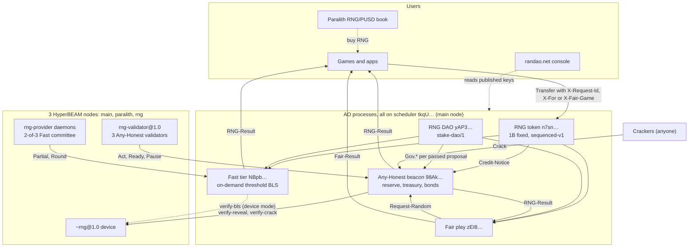
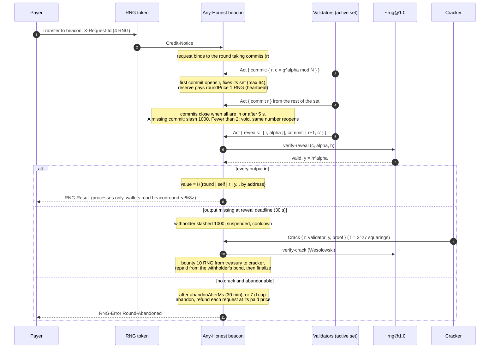
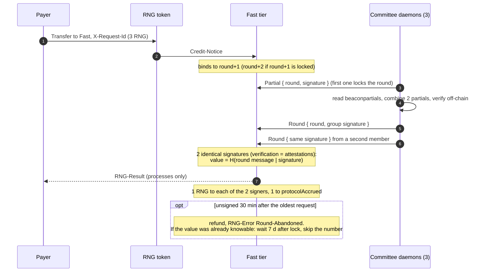
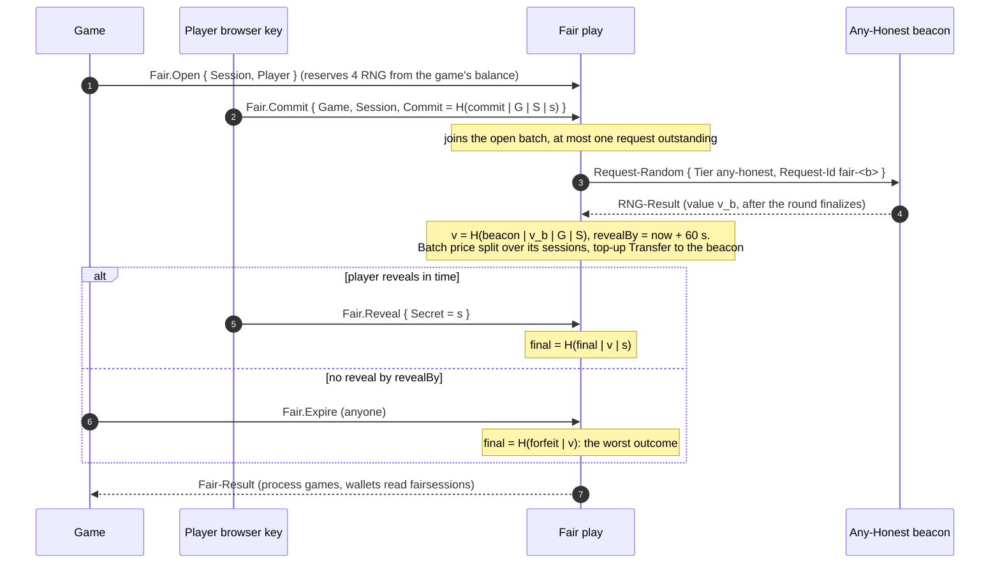
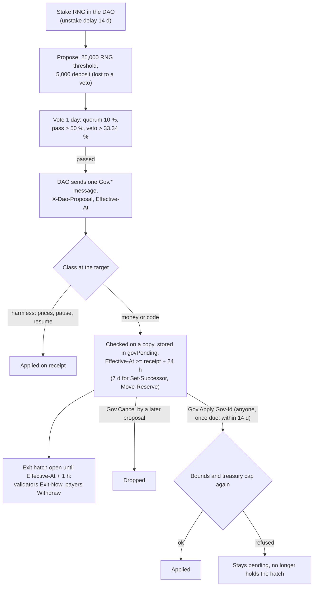
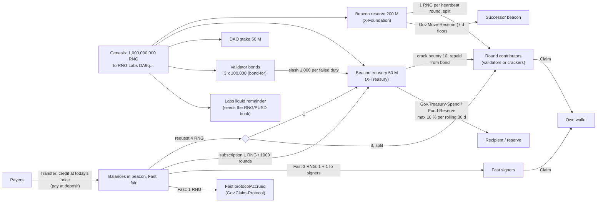

# Architecture (v3, live)

How RNG works today on AO mainnet (HyperBEAM). Process ids are from
[`deploy/v3-mainnet.json`](../deploy/v3-mainnet.json); rules are from the code in
[`protocol/`](../protocol/) and [`validator/`](../validator/). The design record is
[PERMISSIONLESS.md](PERMISSIONLESS.md); the paper is [whitepaper/](whitepaper/).
The abandoned January 2026 multi-chain design is in
[history/architecture-2026-01/](history/architecture-2026-01/).

## Processes

| Role | Process id | Code | Runs on |
|---|---|---|---|
| RNG token | `n7snPbrtwBA4LIlYMHHavzSZSrbUmheSLhw1uuX-KSY` | `protocol/token/rng-token.lua` | `lua@5.3a` |
| RNG DAO (YapDAO `stake-dao/1`) | `yAP3NXPHkz0m59Jm95iYlT6-qdqpBU50Cv9dwUBz6qk` | paralith-mono `dao.lua` (rules in `daoRules`) | `lua@5.3a` |
| Any-Honest beacon | `98AkinkWAtW2NM-csO-D1GNI-lJqf3xWbX-TgeupWUM` | `protocol/beacon/anyhonest.lua` | `lua-patch@1.0` |
| Fast tier | `NBpbTl643CXrRx3IIbN712O2_ZXbhbbFJZZhlcmOTsY` | `protocol/beacon/beacon.lua` | `lua@5.3a` |
| Fair play | `zEI8l8oaThgvIzd60ZyioW6TLZR10yKoeMTgp56TopE` | `protocol/fair/fair.lua` + `lib/fair.lua` | `lua@5.3a` |
| Subscription test consumer | `qxYgg3GQ0Tl4kwDAk3azOoWjHgK5upvk9-OeVjjgz2c` | `protocol/test/subscription-consumer.lua` | `lua@5.3a` |
| Scheduler (all of the above) | `tkqULqMDeHKXCN79Cm_bDIV560JxXl6pBSmdPgxqwSw` | HyperBEAM `scheduler@1.0` | main node |

Retired: Fast `VIsVLEi6…`, fair `QsKxU7KZ…` (replaced 2026-11-08). The beacon,
Fast tier and fair play are owned by the DAO only (`owners.*.walletRenounced`).

## System map

Every process believes another process only through a `from-process` that this
one scheduler signed (`actor()` in `anyhonest.lua`), so the token, DAO and
protocols all share it.

## Any-Honest round

Defaults from [`deploy/v3-params.json`](../deploy/v3-params.json). Rounds
overlap: round r+1 takes commits while r reveals.

A round with every commit in is not abandoned while the treasury can pay a
bounty, until the 7-day cap (`abandonable()`), so a withholder cannot void a
value after seeing it.

## Fast tier request

No clock: a round exists only when a paid request waits for it.

## Fair-play session

## Governance

Code upgrades are the same path: `Gov.Approve-Code Code-Root Effective-At`, then
anyone sends `Gov.Upgrade` parts; the code installs only at or after
`Effective-At` (`protocol/vendor/gov.lua`).

## Money flows

Governance can never take a bond or a balance: `Gov.Remove-Validator` refunds the
whole bond, and `Withdraw` / `Fair.Withdraw` work at any time, paused or not.
